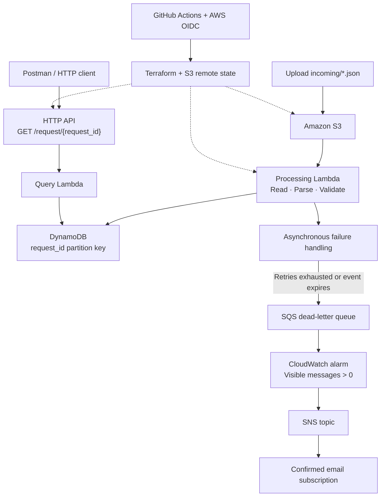

# Serverless Event-Driven Data Pipeline on AWS

[](https://github.com/mreddi8997/Serverless-Event-Driven-Data-Pipeline-on-AWS/actions/workflows/terraform.yml)

A serverless backend for processing IT service requests on AWS. JSON files uploaded to Amazon S3 trigger a Python Lambda function that validates requests and stores them in DynamoDB. An HTTP API retrieves requests by ID, while failed asynchronous processing events are retained in an SQS dead-letter queue with CloudWatch and SNS alerting.

Terraform manages the infrastructure, including adoption of an existing S3 bucket and DynamoDB table through import blocks. GitHub Actions packages the functions and deploys the configuration using AWS OIDC authentication.

This is a portfolio project demonstrating cloud automation, infrastructure as code, event processing, and operational troubleshooting.

## Architecture



S3 invokes Lambda directly; EventBridge is not part of this implementation. The SQS queue is the failure destination, rather than a queue in front of the processing function.

## Implementation highlights

- **Event-driven ingestion:** S3 object-created notifications match the `incoming/` prefix and `.json` suffix.
- **Input validation:** required fields must be nonempty strings; surrounding whitespace is trimmed; only `software_license` requests are accepted.
- **Duplicate protection:** a conditional DynamoDB write prevents an existing request ID from being overwritten.
- **Request lookup:** API Gateway HTTP API uses Lambda proxy integration with payload format 2.0.
- **Failure retention:** unsuccessful asynchronous events can reach an encrypted SQS DLQ with 14-day message retention.
- **Alerting:** a CloudWatch alarm publishes to SNS when visible DLQ messages exceed zero.
- **Separate execution roles:** processing and query functions use distinct IAM roles and CloudWatch logging permissions.
- **Persistent state:** an encrypted S3 backend uses native S3 state locking.
- **Resource adoption:** existing data resources are imported and protected with `prevent_destroy`.

## Technology

| Area | Implementation |
|---|---|
| Infrastructure | Terraform >= 1.15.0, < 2.0.0; AWS provider ~> 6.0 |
| Function runtime | Python 3.14 |
| Storage | Amazon S3 and DynamoDB on-demand capacity |
| API | Amazon API Gateway HTTP API |
| Failure handling | Lambda asynchronous retries and SQS DLQ |
| Monitoring | CloudWatch Logs, CloudWatch alarm, SNS email |
| Deployment | GitHub Actions, TFLint, AWS OIDC |
| Region | us-east-2 |

## Repository layout

```text
.github/workflows/terraform.yml   # Packaging, checks, plan, and deployment
Infra/
├── .gitignore
├── .terraform.lock.hcl
├── backend.tf                   # S3 state backend and locking
├── providers.tf                 # Terraform/provider constraints and region
├── imports.tf                   # Existing bucket/table imports and definitions
├── IAM.tf                       # Function roles and access policies
├── lambda.tf                    # Functions, permissions, and S3 notification
├── api_gateway.tf               # HTTP API, integration, route, default stage
├── sqs.tf                       # Processing DLQ
├── sns.tf                       # SNS, subscription, topic policy, and alarm
├── output.tf                    # API endpoint output
├── s3_lambda.py                 # File processing handler
└── query_lambda.py              # Request lookup handler
```

ZIP packages are generated from the Python source during deployment. The current functions use Boto3 supplied by the Lambda runtime; no `requirements.txt` files are committed.

## Request format

Upload one UTF-8 JSON object per file:

```json
{
  "request_id": "REQ-1001",
  "request_type": "software_license"
}
```

The processing function stores:

```json
{
  "request_id": "REQ-1001",
  "request_type": "software_license",
  "status": "pending"
}
```

Additional input fields are not persisted by the current handler. CSV files, JSON arrays, and bulk record ingestion are not currently supported. Reusing an existing request ID leaves the original item unchanged, even if the new submission contains different values.

## Deployment

### Prerequisites

1. An AWS account and permissions to manage the services in this project.
2. An existing S3 state bucket and backend configuration appropriate for your account.
3. Existing ingestion bucket and DynamoDB table matching `imports.tf`, or an intentional adaptation of that configuration.
4. A GitHub OIDC provider and deployment role in AWS.
5. A GitHub environment named `production`, with accessible variables:
   - `AWS_ROLE_ARN`: deployment role ARN.
   - `AWS_REGION`: `us-east-2`.
6. An SNS email address you control, configured in `sns.tf`.

The checked-in backend uses `terraform-backend-mohit` and key `serverless/terraform.tfstate`. The imported resources are bucket `this-is-a-test-bucket-1234567890` and table `servicerequest`. Change these account-specific settings before reusing the repository. The state bucket must exist before initialization.

The deployment role needs backend/lock-object access, infrastructure deployment permissions, and permission to pass the Lambda execution roles. Its trust policy must match this repository's actual OIDC subject, including the `production` environment. Do not commit AWS credentials, state, or saved plans.

### GitHub Actions

The [deployment workflow](.github/workflows/terraform.yml) runs on pushes to `main` and through **Actions → Deploy serverless lambda → Run workflow**.

It performs:

1. Checkout and OIDC authentication.
2. AWS identity verification.
3. Packaging of both Python handlers.
4. Terraform 1.15.0 setup and backend initialization.
5. Terraform formatting checks.
6. TFLint initialization and lint checks.
7. Terraform plan.
8. Terraform apply with automatic approval.

**Current behavior:** a successful run proceeds automatically from plan to apply. The plan is not saved as a binary artifact; apply generates its own plan. Environment protection rules, if configured in GitHub, gate the entire job before it starts. The workflow does not implement a separate post-plan approval gate or pull-request validation trigger.

[Verified successful workflow run](https://github.com/mreddi8997/Serverless-Event-Driven-Data-Pipeline-on-AWS/actions/runs/39492210390).

### Optional local workflow

The primary deployment path is GitHub Actions. For an authorized local deployment, authenticate to the intended AWS account, review account-specific values, and run the following from a shell with `zip` available:

```bash
cd Infra
zip -j s3_lambda.zip s3_lambda.py
zip -j query_lambda.zip query_lambda.py
terraform init
terraform fmt -check -recursive
terraform validate
terraform plan -out=tfplan
terraform apply tfplan
terraform output -raw api_endpoint
```

Review imports, additions, updates, and deletions before applying. Keep the same backend and state key across local and CI use.

## Test the pipeline

### 1. Upload a valid request

Save the sample JSON above as `request-1001.json`, then upload it:

```bash
aws s3 cp request-1001.json \
  s3://YOUR-INGESTION-BUCKET/incoming/request-1001.json \
  --region us-east-2
```

In DynamoDB, verify that `REQ-1001` exists with status `pending`. The project owner confirmed this successful upload-to-table path. S3 invokes the processing function asynchronously, so its logs do not provide an HTTP 200 response for the upload.

Upload a request with the same ID again to check that the existing item is preserved. For multiple records, use separate files with distinct IDs.

### 2. Query through the API

Retrieve the `api_endpoint` Terraform output from initialized state, or obtain the invoke URL in API Gateway.

In Postman, select **GET** and request:

```text
<api_endpoint>/request/REQ-1001
```

Or use:

```bash
curl -i "<api_endpoint>/request/REQ-1001"
```

| Scenario | Handler behavior |
|---|---|
| Existing request ID | 200 with the stored item |
| Unknown request ID | 404 with an error message |
| Missing path parameter passed directly to the handler | 400 |
| DynamoDB client error | 500 |

The base URL alone does not match the configured route and returns a route-level 404. The current route has no configured authorizer and is publicly callable; use fictional lab data.

### 3. Exercise failure handling

Confirm the SNS email subscription, then upload a new file with an unsupported request type, such as `"request_type": "unsupported"`.

The processing function raises an exception. After asynchronous retries are exhausted, or the event expires, inspect the SQS DLQ and CloudWatch alarm. Allow time for retries and metric evaluation. The alarm sends a notification when it enters ALARM, not once for every failed file.

The DLQ retains the invocation event referencing the S3 object, not a backup of the object's contents. Preserve the source object. Recovery requires inspecting the cause and explicitly replaying corrected work; automated replay is not implemented.

## Logs and troubleshooting

| Symptom | Check |
|---|---|
| No processing invocation | Exact S3 key, notification filters, destination, and region |
| `KeyError: 'Records'` | Event source: the processor expects an S3 object-created event; arbitrary test payloads and S3 setup test events have a different shape |
| API base URL returns 404 | Append `/request/<request_id>` |
| Query returns 404 | Confirm the ID exists in the configured table |
| Access denied | Execution-role permissions, deployment-role permissions, and resource policies |
| No SNS email | Subscription confirmation, alarm state transition, and SNS topic policy |

Function logs are available under `/aws/lambda/process-service-request` and `/aws/lambda/query-service-request`. API Gateway access logging is not provisioned in the current Terraform.

## Deliverables and evidence

| Requested deliverable | Repository status |
|---|---|
| Terraform infrastructure and remote state | Present; existing S3/DynamoDB resources are imported |
| Two Python handlers | Present under `Infra/` as `s3_lambda.py` and `query_lambda.py` |
| Working CI/CD workflow | Present as `terraform.yml`; successful run linked above |
| Five records from a CSV upload and console screenshot | Current implementation accepts individual JSON files; screenshot not committed |
| DLQ message and SNS email screenshots | Failure handling is configured; screenshots not committed |
| README with deployment and test instructions | This document |

The original brief's `lambdas/` layout, handler names, `requirements.txt` files, and `deploy.yml` filename differ from this repository. The implementation above documents the actual layout. No screenshot or unverified runtime result is presented as evidence.

## Further improvements

- Add automated handler tests and explicit `terraform validate` to CI.
- Save and apply the same reviewed plan with a separate approval gate.
- Add deployment concurrency controls and restrict production branches.
- Remove unused DynamoDB actions from execution policies.
- Handle S3 setup test events explicitly and improve structured logging.
- Add API authentication, access logs, and explicit log retention.
- Add CSV/bulk support if required by the original brief.
- Commit test screenshots and a documented recovery exercise.

## Cost and cleanup

Serverless removes server management, but does not mean zero cost. S3, DynamoDB, API Gateway, Lambda, SQS, CloudWatch, and SNS can incur storage or usage charges.

The imported bucket and table have `prevent_destroy` enabled. A blanket `terraform destroy` will be blocked while it includes those resources. Plan teardown deliberately, preserve data and remote state, and do not remove deletion protection merely to bypass the safeguard.
